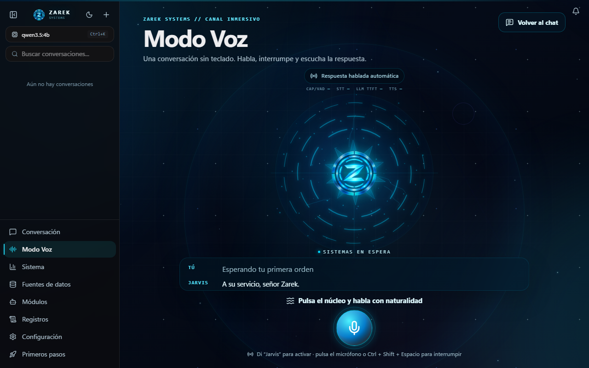
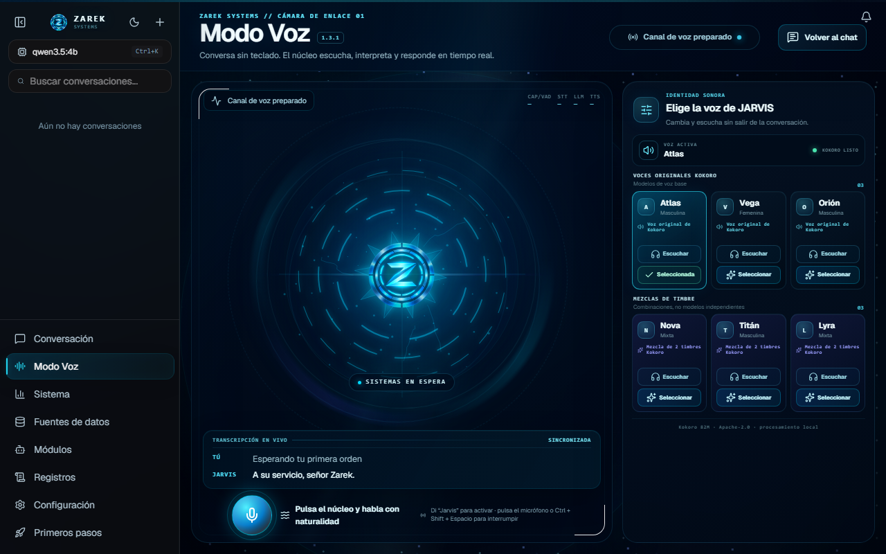

# ZAREK JARVIS AI 1.3.1 — implementación y validación

Fecha: 2026-11-23, zona horaria America/Lima.

## Problema comprobado en 1.3.0

La versión instalada sí contenía `VoicePersonalityPanel` y el endpoint con seis
perfiles, pero Modo Voz no montaba ese catálogo. Para cambiar una voz había que
salir de la conversación, abrir Configuración y desplazarse hasta Voz y
personalidad. Por eso la funcionalidad existía en código, pero era difícil de
descubrir y no aparecía en la pantalla que el usuario usa para hablar.

Además, las tres mezclas se inferían únicamente por el identificador separado
por comas. En 1.3.1 el contrato del backend declara `kind: original|blend` y
`source_voices`, y el frontend mantiene una detección compatible con catálogos
1.3.0 para evitar una pantalla vacía durante una actualización.

## Cambios realizados

### Selector compartido y voz efectiva

- Se creó `VoiceCatalogSelector`, usado tanto en Modo Voz como en
  Configuración → Voz y personalidad. No hay dos catálogos divergentes.
- Modo Voz muestra Atlas, Vega, Orión, Nova, Titán y Lyra sin abandonar la
  conversación.
- Cada tarjeta tiene acciones visibles `Escuchar` y `Seleccionar`, indicador
  `ACTIVA`, disponibilidad del motor y errores reales del backend.
- Atlas, Vega y Orión aparecen bajo “Voces originales Kokoro”. Nova, Titán y
  Lyra aparecen bajo “Mezclas de timbre” y el texto aclara que son
  combinaciones, no modelos independientes.
- Seleccionar guarda inmediatamente `ttsProvider=kokoro` y el `ttsVoiceId` en
  `openjarvis-settings`. La cola TTS ya existente lee esos valores para cada
  respuesta y la selección sobrevive a un reinicio.
- La muestra usa el mismo endpoint `/v1/speech/synthesize`, identificador,
  velocidad, volumen y reactor de audio que las respuestas habladas.

### Rediseño visual

- Se sustituyó la composición vertical por una cabina de dos zonas: reactor de
  conversación y cubierta de voces siempre visible.
- La Z central es más grande y dispone de órbitas, colisión de energía, haz
  volumétrico, nebulosas, estrellas y descargas eléctricas.
- Los estados `listening`, `thinking` y `speaking` cambian color, energía,
  resplandor y movimiento; el núcleo sigue alimentado por el FFT real del
  micrófono y del audio TTS.
- Latencia, estado del canal, transcripción y control de interrupción se
  reorganizaron sin introducir un campo de escritura en Modo Voz.
- La calidad Baja desactiva las animaciones más costosas y el diseño usa una
  consulta de contenedor para resoluciones estrechas.
- Se incorporó Geist Variable y se mejoraron las superficies de la barra
  lateral, mensajes y caja de chat para mayor legibilidad.

## Comparación visual a 1280 × 800

### Antes — versión instalada 1.3.0



### Después — interfaz 1.3.1 compilada y comprobada en el `.exe`



La captura “Después” se generó desde el mismo frontend de producción; después
se instaló el NSIS y se verificó visualmente la misma composición en la ventana
Tauri real.

## Pruebas ejecutadas

| Comprobación | Resultado |
|---|---:|
| Vitest frontend | 146 aprobadas |
| Voz y API dirigidas | 70 aprobadas, 1 omitida |
| Rust/Tauri | 51 aprobadas |
| Build web de producción | Aprobado |
| Build Tauri/NSIS | Aprobado |
| Versión del instalador | 1.3.1 |
| Arranque del ejecutable instalado | Aprobado |
| Catálogo instalado | 6 perfiles |
| Persistencia tras reinstalar y reabrir | Lyra conservada |
| Muestra de Lyra en el `.exe` | Audio reproducido; núcleo en `TRANSMITIENDO` |
| Interrupción de voz | Botón `Detener` aprobado |
| Revisión visual a 1280 × 800 | Sin tarjetas ni controles ocultos |

Comandos reproducibles:

```powershell
npm --prefix .\frontend test -- --run
npm --prefix .\frontend run build
uv run pytest tests\speech\test_tts_backends.py tests\server\test_speech_routes.py -q
cargo test --manifest-path .\frontend\src-tauri\Cargo.toml
npm --prefix .\frontend run tauri -- build --bundles nsis
```

## Artefactos y rutas

- Instalador: `frontend\src-tauri\target\release\bundle\nsis\ZAREK JARVIS AI_1.3.1_x64-setup.exe`
- SHA-256 del instalador:
  `EEA770ADF334A91077F224B09D51A45F7BCE5FBCF9A9AD6F7317FE46D08E58D5`
- Ejecutable instalado:
  `C:\Users\joels\AppData\Local\ZAREK JARVIS AI\zarek-jarvis-desktop.exe`
- SHA-256 del ejecutable instalado:
  `052A7BABC487F8F73545EB37B783310509206136A4BBC0EA2AC2AF83FB60435A`
- Versión de archivo y producto comprobada: `1.3.1`.
- El instalador comunitario no está firmado con Authenticode.

## Archivos de implementación principales

- `frontend/src/pages/VoiceModePage.tsx`
- `frontend/src/components/voice/VoiceCatalogSelector.tsx`
- `frontend/src/components/settings/VoicePersonalityPanel.tsx`
- `frontend/src/index.css`
- `frontend/src/components/Sidebar/Sidebar.tsx`
- `frontend/src/components/Chat/ChatArea.tsx`
- `frontend/src/components/Chat/InputArea.tsx`
- `frontend/src/components/Chat/MessageBubble.tsx`
- `frontend/src/lib/api.ts`
- `src/openjarvis/speech/voice_catalog.py`
- `tests/speech/test_tts_backends.py`
- `tests/server/test_speech_routes.py`

No se añadieron claves, tokens, archivos `.env` ni credenciales al código o al
instalador.
